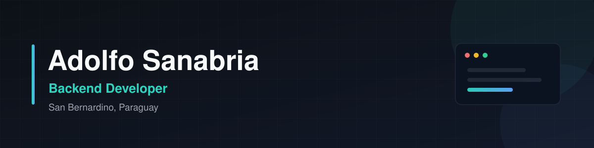

  

<h3 align="center">Backend Developer · Python / FastAPI</h3>

  Construyo APIs y sistemas que resuelven problemas reales, con foco en claridad, seguridad y datos bien modelados.

---

## Sobre mí

Soy **Backend Developer** radicado en San Bernardino, Paraguay. Trabajo principalmente con **Python y FastAPI**, diseño de APIs REST, bases de datos relacionales y despliegue de servicios.

- Desarrollo backend para sistemas de gestión reales (académico, gym y electoral).
- Me interesan la arquitectura limpia, las pruebas y la documentación técnica.
- Disponible para proyectos freelance y colaboraciones.

## Stack

  
  
  
  
  
  
  
  
  
  

## Proyectos destacados

### Plataforma Voto · Proyecto freelance

Sistema web para el control de padrón electoral y confirmación de votos en tiempo real durante jornadas electorales. Permite la operación distribuida entre múltiples operadores y sedes, con sincronización instantánea, auditoría de actividad y modo offline encriptado.

- **Demo:** [plataformavoto.vercel.app](https://plataformavoto.vercel.app)
- **Repositorio:** [starnicosvv/PlataformaVoto](https://github.com/starnicosvv/PlataformaVoto)
- **Stack:** HTML5 · JavaScript · Tailwind CSS · Supabase (PostgreSQL + Realtime)

### Sistema Académico UCA V2 · Colaboración

Plataforma integral de gestión académica para una universidad, con módulos para alumnos, docentes y administración. Desarrollada en equipo con [@dual-devs0](https://github.com/dual-devs0).

- **Mi rol:** backend completo — API, autenticación, base de datos y reglas de negocio.
- **Repositorio:** [dual-devs0/sistema-academico](https://github.com/dual-devs0/sistema-academico)
- **Stack:** FastAPI · SQLAlchemy · Alembic · PostgreSQL (Supabase) · JWT · React

## Otros proyectos

| Proyecto | Descripción | Stack |
|---|---|---|
| [Portfolio](https://github.com/starnicosvv/Portfolio) | Portfolio personal con estética retro 8-bit | HTML · CSS · JavaScript |
| [Python-Proyects](https://github.com/starnicosvv/Python-Proyects) | Suite de aplicaciones de consola en Python | Python |
| [TrabajoPracticoLP2](https://github.com/starnicosvv/TrabajoPracticoLP2) | CRUD académico con ASP.NET WebForms | C# · ASP.NET · JavaScript |

## Contacto

  
  

San Bernardino, Paraguay · Abierto a nuevos proyectos

